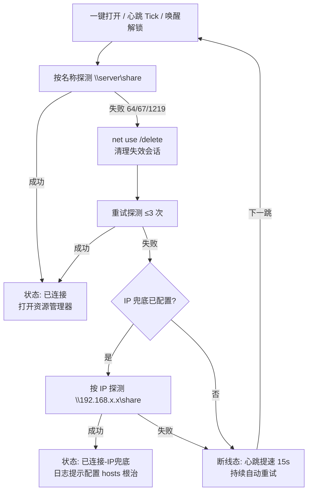

# 共享文件夹一键直达 · ShareFolderQuickAccess

> 专治局域网 SMB 共享「时好时坏」的 Windows 小工具：**打开前自动探测、失效会话自动清理、名称解析失败自动 IP 兜底、空闲断连自动保活、唤醒解锁秒重连**——把 0x80070043 这类间歇性访问失败变成历史。

  

## 🩺 它解决的典型症状

在公司/家里的 Wi-Fi 下访问 `\\文件服务器\某共享`，经常遇到：

- 报错 `0x80070043 找不到网络名`（错误 67），关掉重试一下又能开；
- 电脑睡一觉醒来，第一次访问必失败；
- 时好时坏，`ping 服务器名` 偶尔解析不出来，但 IP 直连是通的。

**根因通常是三类**：① 名称解析依赖不可靠的 NetBIOS/LLMNR 广播（例如 WLAN 的 DNS 被配成了公网 DNS）；② 空闲会话被服务端单方面断开，客户端拿着死会话去连；③ 睡眠唤醒后旧连接残留。本工具针对这三类问题逐层自愈。

## ✨ 核心能力（四层递进保险）

| 层 | 机制 | 治什么 |
|---|---|---|
| 1️⃣ | **打开前探测 + 会话自愈**：轻量枚举共享根目录触发 Tree Connect；失败自动 `net use /delete` 清理失效会话并重试（最多 3 次），**确认连通才打开资源管理器** | 错误 64 / 67 / 1219（失效会话） |
| 2️⃣ | **IP 兜底直连**：名称路径仍失败时，自动改用 `\\<IP>\共享名` 访问（IP 界面可配、留空禁用） | 错误 53（名称解析失灵） |
| 3️⃣ | **保活心跳**：按设定间隔（默认 60s）静默探测，断连自动恢复；**掉线期间自动提速到 15s 快速自愈**；窗口藏在托盘时恢复会弹通知 | 空闲断连、瞬断 |
| 4️⃣ | **唤醒/解锁秒重连**：监听系统电源与会话事件，睡眠唤醒、解锁屏幕的瞬间主动重建会话，不等心跳 | "睡醒第一次必失败" |
| 5️⃣ | **凭据弹窗**：探测遇到认证类错误（5 / 86 / 1219 / 1326）时弹出用户名/密码对话框，用 `WNetAddConnection2` 带凭据直连；可选将凭据存入 **Windows 凭据管理器**（系统加密保管，不落配置文件），此后心跳也能自动使用；1219 冲突自动清会话重试 | 目标名/兜底 IP 无缓存凭据 |
| 6️⃣ | **一键写入 hosts 根治**：把「IP 兜底」里的 IP 与服务器名映射一键写入系统 hosts——先只读检查是否已存在，缺失时经确认弹窗走 UAC 提权子实例写入（自动备份 `hosts.bak`、只追加不重写），随后刷 DNS 并立即重连验证 | 名称解析依赖广播、长期失灵 |

另有：🩺 **一键诊断**（名称解析结果 + `net view` + `net use` 直接打在日志里）、托盘常驻、**单实例保护**、配置持久化（`%AppData%\ShareFolderQuickAccess\settings.json`）。

## 🔄 连接决策流程



## 🚀 快速开始

**环境要求**：Windows 10/11 + [.NET 10 桌面运行时](https://dotnet.microsoft.com/download/dotnet/10.0)

```powershell
# 克隆并运行
git clone https://github.com/LuoCoreOpenCode/ShareFolderQuickAccess.git
cd ShareFolderQuickAccess
dotnet run --project ShareFolderQuickAccess -c Release
```

**发布为单文件 exe**（便于分发）：

```powershell
dotnet publish ShareFolderQuickAccess -c Release -r win-x64 --self-contained false `
  -p:PublishSingleFile=true -o publish
```

### 两种日常用法

1. **常驻模式**：启动主程序 → 关闭按钮自动缩到托盘 → 心跳全天保活。
   想开机自启：`Win+R` 输入 `shell:startup`，把 exe 快捷方式放进去。
2. **启动器模式**：桌面快捷方式目标填 `ShareFolderQuickAccess.exe --open`——
   双击 = 自动探测 → 自愈 → 打开共享 → 退出，成功时连窗口都不留。

## ⚙️ 配置项

界面即配置，关闭时自动保存到 `%AppData%\ShareFolderQuickAccess\settings.json`：

| 配置 | 说明 | 默认 |
|---|---|---|
| 共享路径 | 要直达的 UNC 路径 | `\\server\share` |
| IP 兜底 | 名称解析失败时改用的服务器 IP，留空禁用 | 服务器实际 IP |
| 保活心跳 | 开关与间隔（15–600 秒） | 开 / 60s |
| 关闭最小化到托盘 | 关窗口后心跳继续运行 | 开 |

## 📖 错误码速查（工具日志中的中文提示对照）

| Win32 错误 | 含义 | 工具行为 |
|---|---|---|
| 5 | 拒绝访问 | 提示权限/凭据问题；首次可在资源管理器访问并勾选"记住凭据" |
| 53 | 找不到网络路径 | 打印名称解析结果 → 走 IP 兜底 |
| 64 / 67 | 网络名失效/找不到网络名 | 自动清理会话重试（0x80070043 即 67） |
| 1219 | 同服务器多账号凭据冲突 | 清理会话时一并处理 |
| 86 / 1326 | 需要密码 / 密码错误 | 提示更新凭据 |

## 🌱 根治建议（工具是兜底，网络配置才是根治）

1. **hosts 静态解析**（管理员 PowerShell）：`192.168.x.x  服务器名` + `ipconfig /flushdns`，从此不依赖广播；
2. 请网管给服务器做 **DHCP 保留**（固定 IP）；
3. 关闭本机网卡节能（设备管理器 → 网络适配器 → 电源管理）；
4. 有条件的话把 WLAN 的 DNS 指向**内网 DNS 服务器**。

## 🧑‍💻 项目结构

```
ShareFolderQuickAccess.slnx
ShareFolderQuickAccess/
├── Program.cs               # 入口：单实例 Mutex、--open 启动器模式
├── MainForm.cs              # 业务逻辑 partial：探测重试、IP 兜底、心跳、系统事件
├── MainForm.Designer.cs     # VS 设计器文件：控件布局与事件绑定
├── ShareAccess.cs           # 核心工具：SMB 探测、会话清理、net.exe 诊断、错误码翻译
├── AppSettings.cs           # 设置持久化（%AppData%\...\settings.json）
└── README.md                # （本文件）
```

> 开发提示：`InitializeComponent()` 为设计器生成区，事件统一绑定到具名方法，运行时配置在构造函数中经 `ApplySettingsToUi()` 覆盖设计器默认值——改 UI 直接双击 `MainForm.cs` 进设计器即可。

## License

暂未指定。欢迎提 Issue 交流 SMB 疑难杂症～
